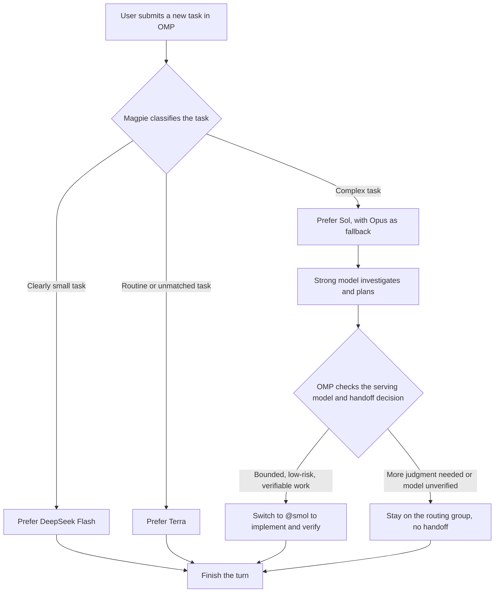

# OMP + Magpie Smart Workflow

[简体中文](README.zh-CN.md)

**Route by task difficulty, then hand bounded implementation to a smaller model without starting a new conversation.** Magpie chooses the model for the turn; the OMP extension handles the optional switch after planning.

## Workflow architecture

You do not need to choose a model up front, and not every complex task is handed off. **Magpie decides which model starts the turn; OMP decides whether to switch after planning.** The handoff stays in the same conversation, so there is no need to restate the problem or copy context.

**Example: fix intermittent duplicate execution in a scheduler.** Sol first traces retries and concurrent execution. If it confirms that two workers can claim the same task and can specify the fix, the invariants to preserve, and a regression case, it can hand implementation to `@smol` (Terra in this example). If the lock and transaction boundaries are still unclear, it chooses `keep` and continues investigating on the routing group.

## Routing reference

| Task | Preferred model in this example |
| --- | --- |
| Short factual question, one specified command, or one mechanical edit | DeepSeek Flash at low effort |
| Routine work or no intent match | GPT-6.1 Terra |
| Architecture, migration, unclear root cause, or difficult invariants | GPT-6.2 Sol; Claude Opus as fallback |
| Compaction | Terra, then Flash if needed |
| Bounded implementation after planning | The OMP `@smol` role, Terra in this example |

On a complex change, the planner investigates first. It can hand off a concrete plan covering files, decisions, constraints, and verification, or decide to keep working on the routing group when implementation still needs judgment. The extension verifies the actual planner against Magpie's completed routing record for that response and session. It prompts once at the first eligible `edit`, `write`, or `apply_patch` batch if the planner has not decided yet. An explicit `keep` closes the handoff for that task. A new prompt submitted after the task settles restores the routing group unless the user has since selected a model, thinking level, or mode.

## Install

1. Use [OMP](https://github.com/can1357/oh-my-pi) and a **local** Magpie gateway with providers you can access. The reference environment is Windows, OMP `19.1.0`, and Magpie `0.1.4573`. Other versions and OSes have not been verified. You do not need the author's provider accounts; substitute your own exact model IDs.
2. Follow [the Magpie routing example](examples/magpie-routing.md). Make `group/smart-workflow` available to OMP in Magpie's Agents view or with `magpie omp group/smart-workflow`. If OMP is already connected to Magpie, you can keep its provider setup.
3. Merge the [`modelRoles` example](examples/omp-config.yml) into your active OMP `config.yml` (default `~/.omp/agent/config.yml`). Do not replace the whole config. Point `@smol` at a tool-capable execution model, not the routing group. If you use different planners, edit `PLANNERS` in the extension to match their **served** provider/model names.
4. Copy `auto-model-handoff.ts` into the active agent directory's `extensions/` and restart OMP. Check `/extensions` for `auto-model-handoff`. The extension expects routing logs at `~/.config/magpie/routing`. If you moved Magpie's data, set `ROUTING_DIR` in the extension to the actual log directory.

## Verify

- Run `magpie group smart-workflow` and confirm the member order, classifier, and rule priorities. Start OMP without a model override. Ask a short factual question, then a complex workspace question. The OMP model picker may show only `magpie/group/smart-workflow`; use the matched completed Magpie routing records to see which model actually served each request. Intent classification and failover mean the preferred model is not guaranteed.
- In a disposable workspace, ask for a change that needs investigation but has bounded edits once the design is known. Check for a successful `handoff_to_implementation` result, the switch to `@smol`, and the real file change and verification. Wait for completion, send a fresh prompt, and check that the routing group is active again.

## Boundaries

- This is model selection, **not a write guard or approval system**. It gives one planning reminder for the named file tools. Shell, nested tools and other mutation paths are not intercepted. OMP's existing approvals still apply.
- OMP 19.1.0 does not expose the dequeue type to `before_agent_start`. In-run steering deliberately keeps the current task, and a queued follow-up may also continue on `@smol`. For guaranteed fresh routing, wait for the task to settle before sending the next prompt.
- Use native Plan Mode or Prewalk **instead of** this extension when you want those workflows. The extension defers to visible Plan Mode and explicit startup `--plan-yolo` / `--prewalk` flags; it cannot observe all ways Prewalk is armed after startup. Disable the extension when using automatic or manually armed Prewalk with this group.
- If the Magpie route record is unavailable or cannot be matched, the extension does not guess the backend or switch models. Routing without automatic handoff still works.
- To disable handoff, turn off `auto-model-handoff` in `/extensions`. To stop using this workflow entirely, also select your previous default model. Leave other OMP settings and credentials untouched.

The repository contains only the extension and example configuration. It does not include provider credentials, routing logs, or session history.
