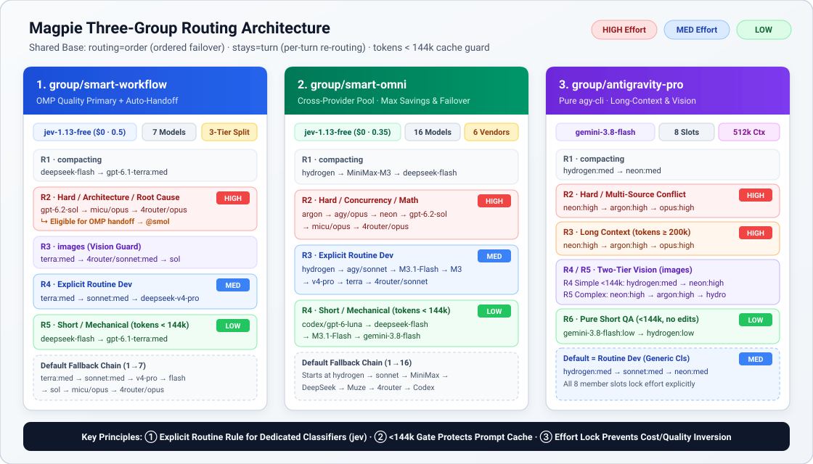
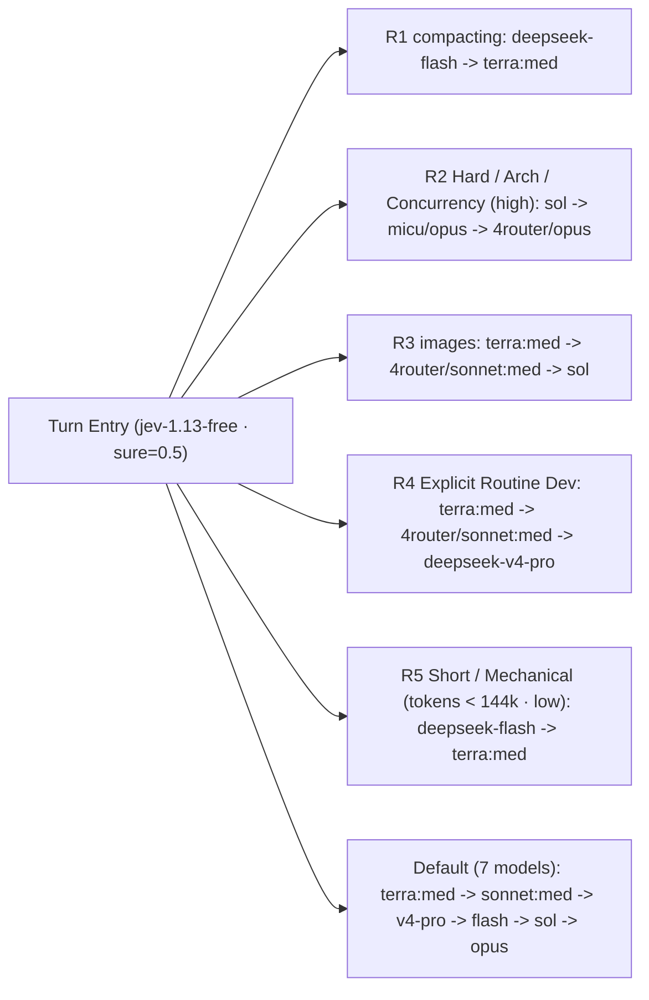
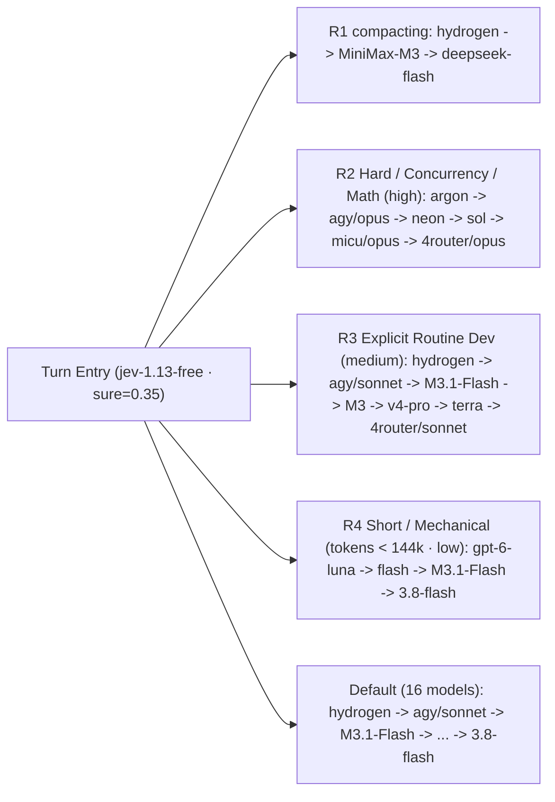
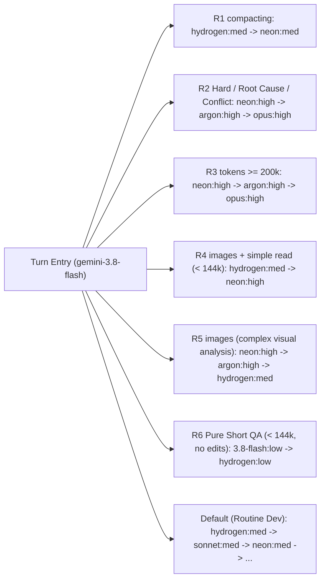
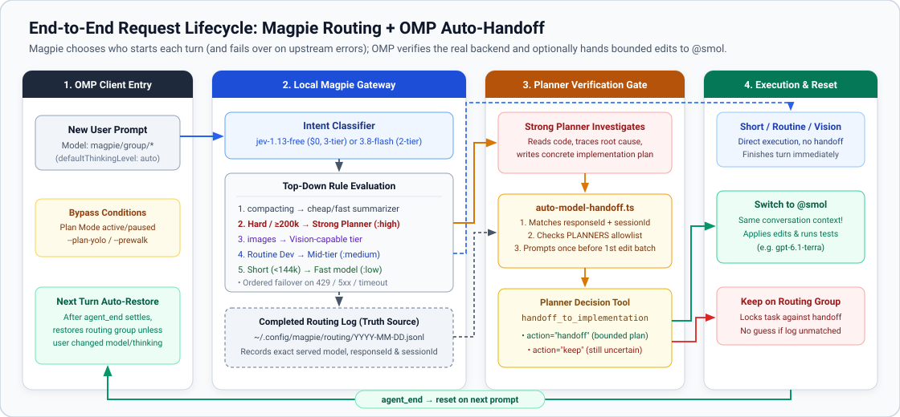
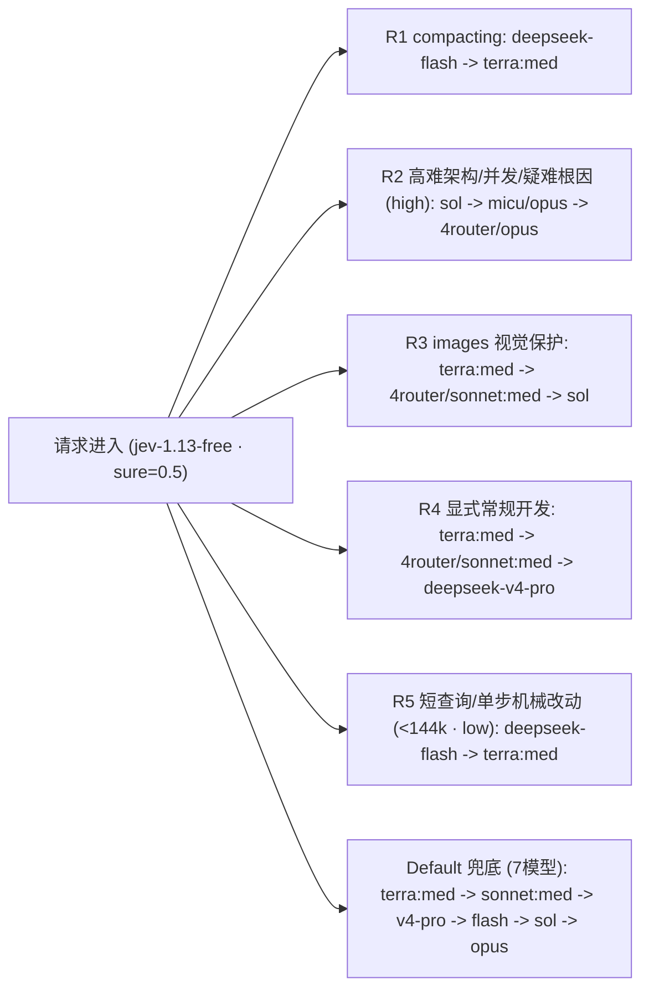
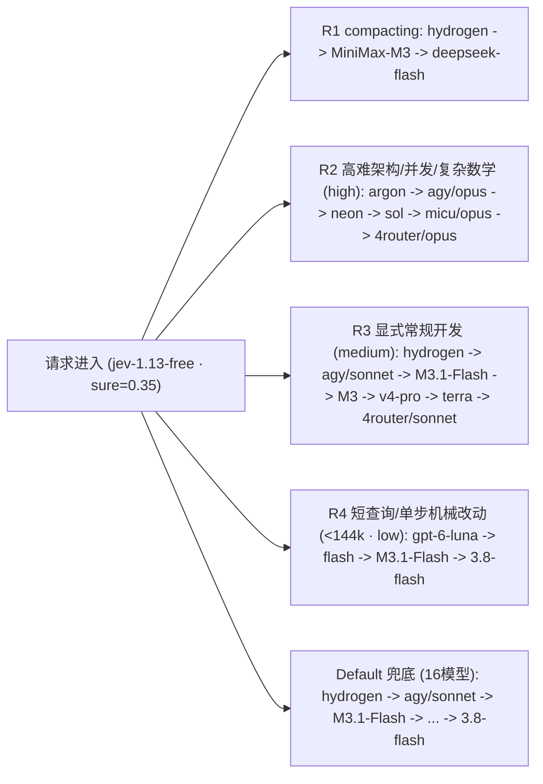
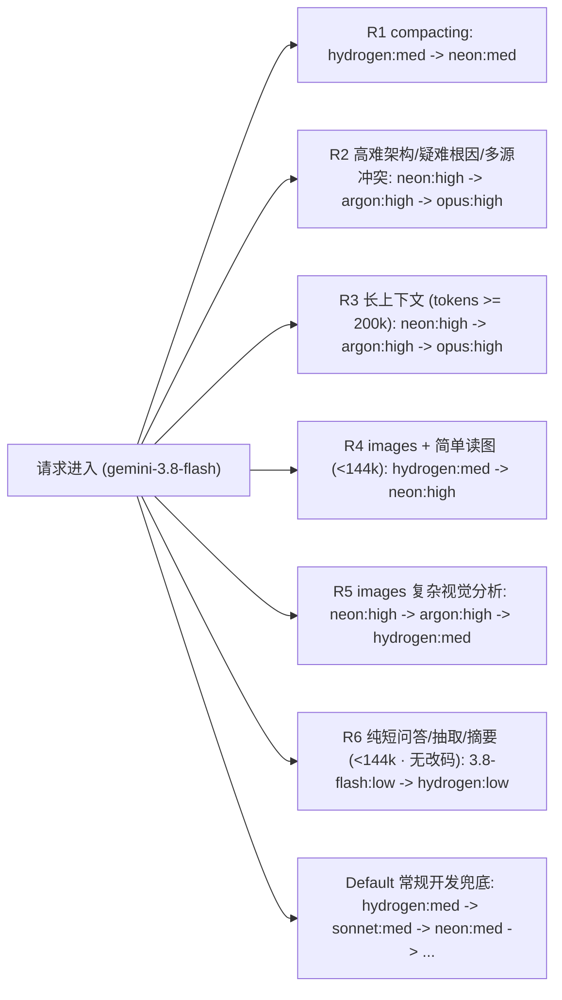

# OMP + Magpie Smart Workflow: Three-Group Routing Architecture & Field Notes

<p align="center">
  <strong><a href="#english">English</a></strong> &nbsp;·&nbsp;
  <strong><a href="#简体中文">简体中文</a></strong> &nbsp;·&nbsp;
  <a href="README.zh-CN.md">Standalone Chinese (独立中文版)</a>
</p>

---

<a id="english"></a>

## English

**A reproducible, battle-tested multi-model routing architecture for [OMP (oh-my-pi)](https://github.com/can1357/oh-my-pi) and a local Magpie gateway—combining three complementary routing groups with optional same-session planning-to-implementation handoff.**

This repository serves two purposes:
1. **Architecture & Field Notes** — Share the concrete rules, real routing evidence, and lessons learned while tuning intent classification, reasoning effort, prompt cache protection, and failover across providers.
2. **One-Command Machine Rebuild** — Let anyone (or yourself on a fresh machine) rebuild the exact three-group workflow in minutes without copying credentials or re-deriving edge cases.



---

### 1. Three Routing Groups at a Glance

All three groups share the same foundation: **`routing=order`** (deterministic ordered failover on 429/5xx/timeouts) and **`stays=turn`** (independent re-routing on every new user turn).

| Dimension | `group/smart-workflow` | `group/smart-omni` | `group/antigravity-pro` |
| --- | --- | --- | --- |
| **Role** | OMP quality primary + auto-handoff | Cross-provider pool for max token savings & failover | Pure `agy-cli` pool for long-context & multimodal work |
| **Classifier / Threshold** | `jev-1.13-free` (`$0`) / `0.5` | `jev-1.13-free` (`$0`) / `0.35` | `agy-cli/gemini-3.8-flash` / default |
| **Intent Split Style** | **Explicit 3-tier** (Hard / Routine / Short) | **Explicit 3-tier** (Hard / Routine / Short) | **2-pole + Default Routine** (general LLM classifier) |
| **Pool Depth** | 7 models (4 providers) | 16 models (6 providers) | 8 effort-locked slots (1 provider, 512k ctx) |
| **Vision (`images`)** | 1 rule: `terra:med -> sonnet:med -> sol` | Falls through to Default (`hydrogen` first) | 2-tier split: `<144k` simple (`hydrogen`) vs complex (`neon:high`) |
| **Context Gates** | Short tasks guarded by `tokens < 144k` | Short tasks guarded by `tokens < 144k` | `tokens >= 200k` promotes to `neon:high`; simple vision & short QA `< 144k` |
| **Effort Locking** | Rule + member locked (`high` / `medium` / `low`) | Rule-level locked (`high` / `medium` / `low`) | All 8 members hard-locked (`high` / `medium` / `low`) |
| **OMP Auto-Handoff** | **Active** on Rule 2 planners via [`auto-model-handoff.ts`](auto-model-handoff.ts) | Not active (routing-only) | Not active (routing-only) |

---

### 2. Per-Group Rule Topology

#### Group 1 — `group/smart-workflow` (Quality Primary + Auto-Handoff)

Designed as the daily high-confidence coding driver. Free intent classification separates short lookups, routine coding, vision turns, and hard architectural reasoning; when a strong planner in Rule 2 finishes investigating a bounded change, OMP can switch to `@smol` inside the same conversation.



#### Group 2 — `group/smart-omni` (Cross-Provider Pool · Max Savings & Failover)

Designed for rate-limit resilience and off-peak cost efficiency. Spans 16 models across 6 providers (`agy-cli`, `minimax-code`, `deepseek`, `muze`, `4router`, `micu`, `codex`) so no single provider outage or quota cap interrupts a session.



#### Group 3 — `group/antigravity-pro` (Pure `agy-cli` · Long-Context & Two-Tier Vision)

Designed for massive contexts (512k window, auto-escalation at `>= 200k` tokens), document/screenshot analysis, and staying purely inside a single `agy-cli` subscription pool with strict member-level effort locks.



---

### 3. End-to-End Lifecycle & Same-Session Handoff

**Magpie decides who starts the turn; OMP decides whether to hand off after planning.** Keeping the handoff in the same conversation avoids restating context, copying diffs, or starting a fresh session.



How [`auto-model-handoff.ts`](auto-model-handoff.ts) avoids fragile guesswork:
- **Log-verified planner identity**: Instead of trusting shared response headers, the extension matches `message.responseId` and `ctx.sessionManager.getSessionId()` against Magpie's completed records in `~/.config/magpie/routing/YYYY-MM-DD.jsonl` (with a single 100 ms retry if the flush is slightly behind). If unmatched, it never guesses or switches.
- **Single-batch reminder, not a write lock**: If an eligible strong planner starts calling `edit`, `write`, or `apply_patch` before deciding, the extension interrupts that initial batch once so the planner can call `handoff_to_implementation` with either `action: "handoff"` (concrete plan -> switch to `@smol`) or `action: "keep"` (locks the task on the routing group).
- **Automatic restoration**: Once `agent_end` settles, the next fresh prompt restores `group/smart-workflow`, unless the user manually changed model, thinking level, or mode in between.

---

### 4. Workflow Engineering Lessons (What Actually Mattered in Practice)

These six lessons come directly from inspecting real `~/.config/magpie/routing/*.jsonl` traces and fixing live routing bugs.

#### Lesson 1: Dedicated Free Classifiers Need an **Explicit Routine Dev Rule**

> [!IMPORTANT]
> When `jev-1.13-free` only has two intent rules (**Hard** vs **Short**), it strongly prefers forcing routine coding tasks into the Hard rule instead of falling through to Default.

- **Observed failure**: In live gateway tests with only 2 intents, *"Write a JSONL-to-CSV script with unit tests"* was routed to `gpt-6.2-sol:high` (`sure=0.84`) in `smart-workflow`, and *"Implement an O(1) LRU cache with unit tests"* was routed to `gemini-4-argon:high` in `smart-omni`.
- **Fix**: Adding an explicit middle-tier **Routine Dev** intent rule fixed both immediately (`sure=0.985–1.0`), restoring `gpt-6.1-terra:medium` and `gemini-4-hydrogen:medium` while cutting classifier latency from ~2.93s (paid LLM) down to `0.37–1.25s` at `$0`.
- **When NOT to add it**: General-purpose LLM classifiers like `gemini-3.8-flash` (used in `antigravity-pro`) reliably return *"none of these"* for normal work, so letting unmatched turns fall through to Default stays simpler and avoids maintaining a third prompt boundary.
- **Tradeoff to know**: A loosely worded prompt (e.g., *"fix this bug"*) for a secretly nasty race condition may start on the Routine tier. Because `stays=turn`, following up with architectural/concurrency clues immediately escalates the next turn.

#### Lesson 2: Always Lock Reasoning Effort (Prevent Cost/Quality Inversion)

Before effort locking, historical logs showed two inversions happening simultaneously:
- ~30% of **hard** architectural turns ran at `low` reasoning effort when the client requested `low/auto`;
- **Routine** edits burned `high` reasoning tokens unnecessarily.

Locking effort explicitly—either via member suffixes (`model:medium`, `model:high`, `model:low`) or rule overrides (`use-effort=high|medium|low`)—eliminated both inversions completely. Live 3-way verification confirmed:

| Test Prompt | Client Sent Effort | Matched Rule | Classifier Latency / Confidence | Served Model | Actual Effort Sent |
| --- | --- | --- | --- | --- | --- |
| Short command (`"Reply with OK only."`) | `high` | `smart-workflow` R5 / `smart-omni` R4 | `1029–1250ms` / `sure=1` | `deepseek-flash` / `gpt-6-luna` | **`low`** |
| Routine coding (JSONL→CSV / LRU Cache + tests) | `high` | `smart-workflow` R4 / `smart-omni` R3 | `430–508ms` / `sure=0.985–1` | `gpt-6.1-terra` / `gemini-4-hydrogen` | **`medium`** |
| Complex concurrency invariants | `low` | `smart-workflow` R2 / `smart-omni` R2 | `371–431ms` / `sure=1` | `gpt-6.2-sol` / `gemini-4-argon` | **`high`** |

#### Lesson 3: Protect Prompt Cache with `tokens < 144k` and Escalate Long Context at `>= 200k`

- **Why `when="tokens < 144k"` on Short/Simple rules**: Mid-way through a deep 160k-token coding session, typing *"looks good, run tests"* should **not** suddenly switch providers to a cheap flash model—doing so throws away the warm prefix cache and can fail on smaller context limits. Gating short rules below `144k` preserves cache affinity once a session grows large.
- **Why `tokens=200k` on `antigravity-pro`**: Above 200k tokens, long-context recall degrades sharply on mid-tier models; automatically promoting to `neon:high -> argon:high -> opus:high` keeps accuracy high on large repos and docs.

#### Lesson 4: Guard `images` Before Short Intent Rules

Rules evaluate top-to-bottom. Placing `images` **above** short mechanical rules guarantees screenshots never get routed to text-only or weak-vision cheap models. In `antigravity-pro`, splitting vision into **R4 (simple OCR/label check `<144k` -> `hydrogen:med`)** and **R5 (complex visual debugging -> `neon:high`)** saves quota without losing accuracy on hard UI/chart bugs.

#### Lesson 5: Keep One Clean Split Between Gateway Routing and Agent Handoff

- **Gateway (Magpie)** owns stateless per-turn routing, intent classification, effort overrides, compaction, and upstream failover.
- **Agent (OMP + `auto-model-handoff.ts`)** owns stateful multi-step planning vs bounded execution within a single turn.
- Trying to make the gateway guess whether a plan is "done" fails; trying to make OMP manage 16-model cross-provider failover duplicates the gateway. Keeping them strictly separated makes both simple to debug.

#### Lesson 6: Three Purpose-Built Groups Beat One Overloaded Mega-Group

Instead of stuffing every constraint into one giant rule table, switch groups by intent of the session:
- Need maximum coding rigor + automatic strong-plan-to-fast-edit handoff → **`group/smart-workflow`**
- Want minimal bill + 6-provider peak-hour failover → **`group/smart-omni`**
- Working with 200k+ token materials, PDFs, or heavy screenshot analysis on Antigravity Pro → **`group/antigravity-pro`**

---

### 5. Quick Rebuild on a New Machine

Verified baseline: **Windows**, **OMP `19.1.0`**, **Magpie `0.1.4573`** (Bash / Git Bash recommended for scripts).

1. **Connect providers in local Magpie** and check exact model IDs:
   ```sh
   magpie models
   ```
2. **Clone this repository and edit model IDs** in [`examples/setup-groups.sh`](examples/setup-groups.sh) if your provider names differ (remove unavailable fallbacks—never leave dead model IDs).
3. **Create the routing groups** (script refuses to overwrite existing groups unless `--force` is passed):
   ```sh
   chmod +x examples/setup-groups.sh
   ./examples/setup-groups.sh all
   ```
   Or follow the manual CLI guide in [`examples/magpie-routing.md`](examples/magpie-routing.md).
4. **Expose groups to OMP** via Magpie's Agents view or CLI:
   ```sh
   magpie omp group/smart-workflow
   ```
5. **Merge [`examples/omp-config.yml`](examples/omp-config.yml)** into `~/.omp/agent/config.yml` (do **not** overwrite your whole config). Ensure `modelRoles.smol` points to a direct tool-capable model, **not** a routing group.
6. **Install the handoff extension** (if using `smart-workflow`):
   - Copy [`auto-model-handoff.ts`](auto-model-handoff.ts) to `~/.omp/agent/extensions/auto-model-handoff.ts`.
   - If you changed Rule 2 planner IDs, update `PLANNERS` in `auto-model-handoff.ts` to match the **served** `provider/model` names in Magpie's routing logs.
   - If you moved Magpie's data dir, update `ROUTING_DIR`.
   - Restart OMP and verify `auto-model-handoff` is enabled in `/extensions`.
7. **Verify**:
   - Run `magpie group smart-workflow`, `magpie group smart-omni`, and `magpie group antigravity-pro`.
   - Send a short, routine, and complex prompt and check `~/.config/magpie/routing/YYYY-MM-DD.jsonl` for matched rule numbers, `served` model, and final `effort`.

---

### 6. Boundaries & Safety Notes

- **Model selection, not a write guard**: `auto-model-handoff.ts` only reminds once before the first eligible `edit` / `write` / `apply_patch` batch. Shell commands and nested tools are not intercepted; native OMP approvals remain in effect.
- **Queued follow-ups**: OMP `19.1.0` `before_agent_start` does not distinguish mid-run steering from queued follow-ups; a queued follow-up may remain on `@smol`. Wait for a turn to settle before sending a fresh prompt for guaranteed re-routing.
- **Plan Mode & Prewalk**: Do not run `auto-model-handoff.ts` together with automatic or manually armed Prewalk. The extension automatically defers to visible Plan Mode and explicit `--plan-yolo` / `--prewalk` startup flags.
- **Zero secrets**: This repo contains only configuration templates, architecture diagrams, and extension code—never provider keys, routing logs, or session history.

---
---

<a id="简体中文"></a>

## 简体中文

**一套经过真实流量验证、可一键复刻的 [OMP (oh-my-pi)](https://github.com/can1357/oh-my-pi) + 本地 Magpie 多模型路由工作流：包含三个互补策略组的完整架构设计、同会话规划交接扩展，以及可直接照抄的换机搭建脚本。**

本仓库解决两个核心需求：
1. **架构沉淀与建设心得** — 完整记录意图分类器选型、显式常规开发规则、推理深度（Effort）锁定、Prompt Cache 保护与多渠道容灾的真实踩坑与优化过程。
2. **换电脑快速复原** — 新机器只需接入自己的 Provider、跑一遍脚本并合并配置片段，即可在几分钟内复原一模一样的工作框架（仓库不含任何 API Key 或个人日志）。


---

### 一、三大策略组横向对比

三个策略组共用同一底座：**`routing=order`（按序确定性容灾）+ `stays=turn`（每轮用户提问独立重路由）**。

| 维度 | `group/smart-workflow` | `group/smart-omni` | `group/antigravity-pro` |
| --- | --- | --- | --- |
| **定位** | OMP 质量主力 + 自动规划交接 | 全渠道错峰池（极致省 Token + 高容灾） | 纯 `agy-cli` 长上下文与多模态专用 |
| **分类器 / 阈值** | `jev-1.13-free`（免费）/ `0.5` | `jev-1.13-free`（免费）/ `0.35` | `agy-cli/gemini-3.8-flash` / 默认 |
| **意图分流模式** | **显式三档**（高难 / 常规 / 短任务） | **显式三档**（高难 / 常规 / 短任务） | **两极 + Default 接常规**（通用分类器） |
| **容灾池深度** | 7 个模型（4 家渠道） | 16 个模型（6 家渠道） | 8 个锁档槽位（纯 `agy-cli`，512k 上下文） |
| **视觉规则 (`images`)** | 1 条：`terra:med -> sonnet:med -> sol` | 落 Default（首选 `hydrogen`） | **两级视觉分流**：`<144k` 简单读图走 `hydrogen`，复杂走 `neon:high` |
| **长上下文门控** | 短任务限 `tokens < 144k` | 短任务限 `tokens < 144k` | `tokens >= 200k` 强制升格 `neon:high`；简单读图与短问答限 `< 144k` |
| **Effort 锁定** | 规则 + 成员全锁（`high`/`medium`/`low`） | 规则层全锁（`high`/`medium`/`low`） | 全部 8 个成员硬锁（`high`/`medium`/`low`） |
| **OMP 自动交接** | **启用**：Rule 2 强模型联动 [`auto-model-handoff.ts`](auto-model-handoff.ts) | 仅路由，不触发交接 | 仅路由，不触发交接 |

---

### 二、三组精确规则拓扑

#### 策略组 1：`group/smart-workflow`（OMP 质量主力 + 自动交接）

日常高确定性开发主力。用免费专用分类器拆开「短任务 / 常规开发 / 视觉 / 高难架构」；高难任务由强模型先调查定位，方案边界清晰后在同一会话里无缝切给 `@smol` 落地实施。



#### 策略组 2：`group/smart-omni`（全池错峰 · 极省 Token 与高容灾）

面向高并发错峰、低成本和高可用。横向跨越 6 个供应商共 16 个模型（`agy-cli`、`minimax-code`、`deepseek`、`muze`、`4router`、`micu`、`codex`），任意单渠道限流或故障自动顺延下一候选。



#### 策略组 3：`group/antigravity-pro`（纯 `agy-cli` · 长文与两级视觉特化）

面向超长上下文（512k 窗口，`>= 200k` 自动升格）、大量截图/图文排障以及只消耗 Antigravity Pro 额度池的场景。由于采用通用模型 `gemini-3.8-flash` 做分类器，常规开发无需额外规则，直接干净落回 Default。



---

### 三、端到端生命周期与同会话规划交接

**Magpie 负责决定「这一轮由谁开局 + 上游容灾」，OMP 扩展负责决定「强模型规划完后要不要切给轻量模型实施」。** 交接完全发生在同一会话内，无需重述背景或复制上下文。


[`auto-model-handoff.ts`](auto-model-handoff.ts) 的三个关键工程保障：
- **以路由日志为唯一真相，绝不盲猜**：不依赖共享响应头，而是按 `message.responseId` + `ctx.sessionManager.getSessionId()` 精确匹配 `~/.config/magpie/routing/YYYY-MM-DD.jsonl` 中的已完成记录（若落盘稍慢仅补读 1 次，间隔 100 ms）；匹配不到就绝不切换。
- **首批写入单次提醒，而非持续拦截**：如果强模型还没作决定就开始发首批 `edit` / `write` / `apply_patch`，扩展会一次性拦截该批调用，请规划模型调用 `handoff_to_implementation` 明确选择 `handoff`（附具体方案切到 `@smol`）或 `keep`（锁定本任务留在路由组，不再打扰）。
- **任务结算后自动恢复路由组**：等到终态 `agent_end` 结算后，下一条新任务自动切回 `group/smart-workflow`；若期间用户手动改过模型、思考级别或模式，则尊重用户选择不覆盖。

---

### 四、工作流建设心得（实测踩坑与设计原则）

以下六条心得全部来自本地 `~/.config/magpie/routing/*.jsonl` 实测数据与反复调优：

#### 心得 1：用免费专用分类器（`jev-1.13-free`）时，必须加「显式常规开发 Rule」

> [!IMPORTANT]
> 当 `jev-1.13-free` 只有「高难」和「极简」两个选项时，面对普通写代码任务它会强行二选一吸进高难池，而不是放行到 Default。

- **实测踩坑**：仅配 2 个 intent 时，*"写一个 JSONL 过滤转 CSV 脚本加单测"* 在 `smart-workflow` 被送进了 `gpt-6.2-sol:high`（`sure=0.84`）；*"写一个 Python O(1) LRU Cache 加单测"* 在 `smart-omni` 被送进了 `gemini-4-argon:high`。
- **修复效果**：显式插入中间档「常规开发 Rule」后，两类测试全部以 `sure=0.985–1.0` 精准回到 `gpt-6.1-terra:medium` / `gemini-4-hydrogen:medium`；同时分类延迟从付费模型均值 `2.93s` 降至 `0.37–1.25s`，分类成本降为 `$0`。
- **何时不该加**：像 `antigravity-pro` 这样使用通用 LLM（`gemini-3.8-flash`）做分类器时，模型本身会老实返回未命中并落回 Default，此时不加常规 Rule 反而更简洁、少维护一层提示词边界。
- **需要知晓的代价**：措辞偏轻的隐蔽难题（例如只说“修下这个 bug”）首轮可能先落入常规档；但因为 `stays=turn`，一旦发现涉及并发或深层不变量，下一轮追问会立刻升格。

#### 心得 2：必须显式锁定 Reasoning Effort，彻底消灭「成本/质量倒挂」

在锁定 Effort 之前，日志中同时存在两种倒挂：
- 约 30% 的高难架构请求被客户端带成了 `low` 推理深度；
- 大量常规改码任务白白按 `high` 深度空烧推理 token 和等待时间。

通过成员后缀（`:low` / `:medium` / `:high`）和规则级 `use-effort` 双重锁定后，真实网关三档实测结果如下：

| 测试场景 | 请求传入 Effort | 命中规则 | 分类耗时 / 置信度 | 实际派发模型 | 实际发送 Effort |
| --- | --- | --- | --- | --- | --- |
| 短指令（`"Reply with OK only."`） | `high` | `smart-workflow` R5 / `smart-omni` R4 | `1029–1250ms` / `sure=1` | `deepseek-flash` / `gpt-6-luna` | **`low`** |
| 常规开发（JSONL→CSV / LRU Cache + 单测） | `high` | `smart-workflow` R4 / `smart-omni` R3 | `430–508ms` / `sure=0.985–1` | `gpt-6.1-terra` / `gemini-4-hydrogen` | **`medium`** |
| 复杂并发不变量与无锁队列分析 | `low` | `smart-workflow` R2 / `smart-omni` R2 | `371–431ms` / `sure=1` | `gpt-6.2-sol` / `gemini-4-argon` | **`high`** |

#### 心得 3：用 `tokens < 144k` 保护 Prompt Cache，用 `tokens >= 200k` 托底超长上下文

- **短任务加 `when="tokens < 144k"`**：当一个深聊会话已经累积到 160k token 时，哪怕你只回复一句 *"跑一下测试"*，也不能突然切去廉价小模型——那样会直接击穿前缀缓存（Prompt Cache）甚至撞上小模型上下文上限。
- **`antigravity-pro` 加 `tokens=200k` 自动升格**：超过 200k 后轻量模型长程召回明显衰减，直接升格到 `neon:high -> argon:high -> opus:high` 稳住质量。

#### 心得 4：`images` 规则必须排在短任务之前，重视觉场景可做两级分流

Magpie 规则自上而下匹配。把 `images` 放在短任务前，能防止带截图的短提问误入纯文本或弱视觉小模型；在 `antigravity-pro` 里进一步拆成 **R4（`<144k` 简单抄录/看一眼走 `hydrogen:med`）** 和 **R5（复杂排障/多图对比走 `neon:high`）**，既省额度又不丢细节。

#### 心得 5：网关管「无状态选型与容灾」，Agent 管「有状态规划与交接」

- **Magpie（网关层）** 负责每轮开局分类、Effort 覆盖、上下文压缩和上游 429/5xx 故障转移；
- **OMP（客户端扩展）** 负责在强模型完成复杂调研后，判断是否将边界清晰的实施交接给 `@smol`。
- 两者职责彻底解耦，任何一侧出问题都能独立定位和降级。

#### 心得 6：维护三个场景专精组，胜过塞成一个臃肿大杂烩

- 日常重质量、希望强规划自动交接给轻量实施 → 用 **`group/smart-workflow`**
- 想极致省钱、多渠道错峰抗限流 → 用 **`group/smart-omni`**
- 处理 200k+ 超长文档/代码库或高频图文分析 → 用 **`group/antigravity-pro`**

---

### 五、换电脑 / 新环境快速搭建清单

已验证基准环境：**Windows**、**OMP `19.1.0`**、**Magpie `0.1.4573`**（建议使用 Bash / Git Bash 执行脚本）。

1. **先在本地 Magpie 接入你自己的模型渠道**，查看精确的 `provider/model` ID：
   ```sh
   magpie models
   ```
2. **克隆本仓库并按需替换模型 ID**：打开 [`examples/setup-groups.sh`](examples/setup-groups.sh)，把你没有的渠道/模型换成自己的同档位模型（删除不可用的后备项，切勿保留无效 ID）。
3. **一键建组**（默认有防误覆盖保护，确认覆盖才加 `--force`）：
   ```sh
   chmod +x examples/setup-groups.sh
   ./examples/setup-groups.sh all
   ```
   也可参考 [`examples/magpie-routing.md`](examples/magpie-routing.md) 逐条手动执行。
4. **把策略组暴露给 OMP**：在 Magpie 的 Agents 界面勾选，或命令行运行：
   ```sh
   magpie omp group/smart-workflow
   ```
5. **合并 [`examples/omp-config.yml`](examples/omp-config.yml)** 到 `~/.omp/agent/config.yml`（**只合并片段，不要覆盖整个文件**）。注意 `modelRoles.smol` 必须指向支持工具调用的直连模型，不能指向路由组。
6. **安装自动交接扩展**（使用 `smart-workflow` 时）：
   - 将 [`auto-model-handoff.ts`](auto-model-handoff.ts) 复制到 `~/.omp/agent/extensions/auto-model-handoff.ts`；
   - 如果更换了 Rule 2 强模型，同步修改扩展里的 `PLANNERS` 白名单为 Magpie 路由日志里实际 `served` 的 `provider/model` 名称；
   - 若迁移过 Magpie 数据目录，同步调整 `ROUTING_DIR`；
   - 重启 OMP，在 `/extensions` 确认 `auto-model-handoff` 已开启。
7. **快速验收**：
   - 运行 `magpie group smart-workflow` / `smart-omni` / `antigravity-pro` 核对规则顺序与分类器；
   - 分别发一条短提问、常规写码、复杂架构题，检查 `~/.config/magpie/routing/YYYY-MM-DD.jsonl` 中的命中规则号、`served` 模型和最终 `effort`。

---

### 六、使用边界与安全说明

- **模型选择机制，非写入安全门禁**：`auto-model-handoff.ts` 仅在首批 `edit` / `write` / `apply_patch` 前提醒一次；Shell 及其他变更路径不拦截，原有 OMP 审批规则不变。
- **排队 follow-up 行为**：OMP `19.1.0` 的 `before_agent_start` 不区分运行中补充（steering）与排队 follow-up，后者可能沿用 `@smol`。如需确保新任务重新路由，请等当前任务结算后再发下一条。
- **与原生 Plan Mode / Prewalk 互斥**：扩展会自动让位于可见 Plan Mode 及 `--plan-yolo` / `--prewalk` 启动参数；使用自动或手动预装 Prewalk 时请先在 `/extensions` 关闭本扩展。
- **零敏感信息**：本仓库只含架构图、配置模板、建组脚本和扩展源码，不包含任何 API Key、路由日志或会话历史。
