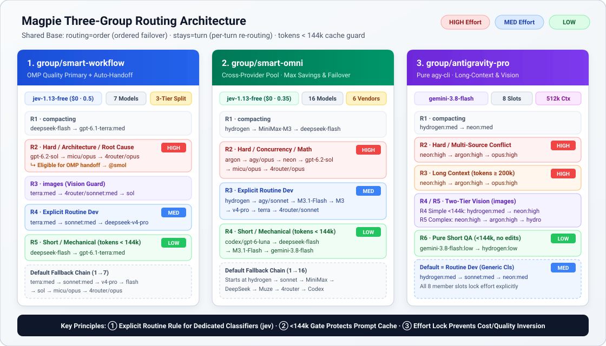
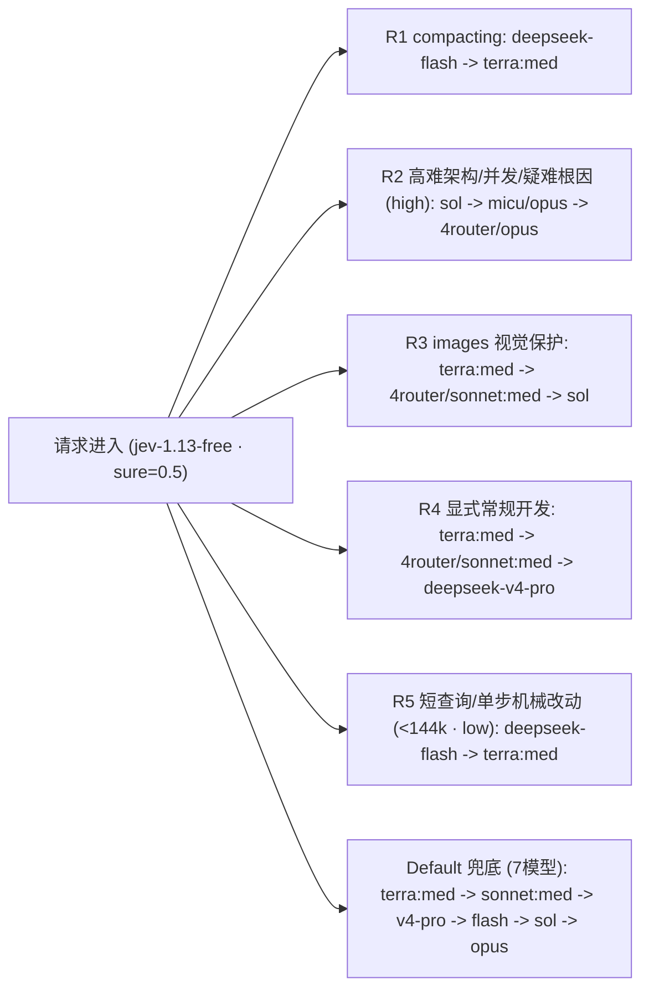
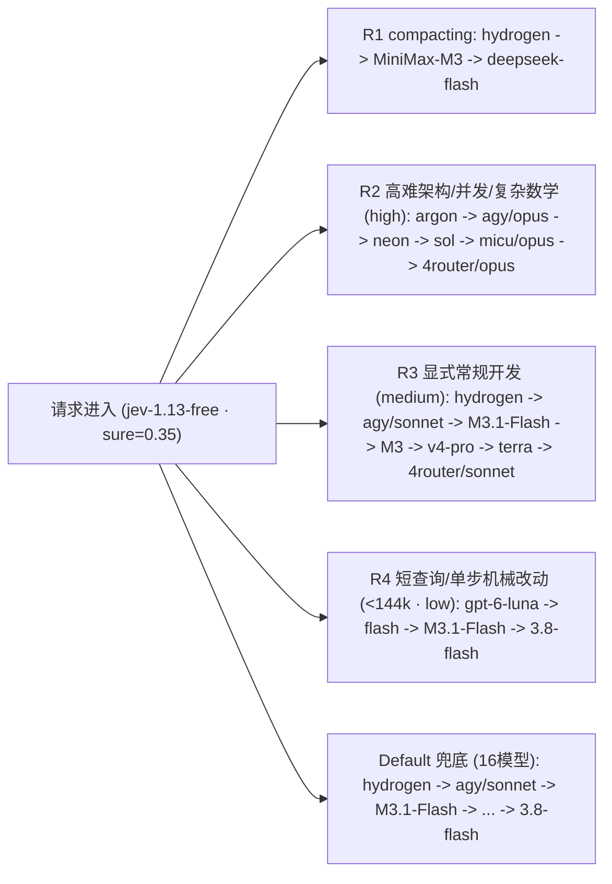
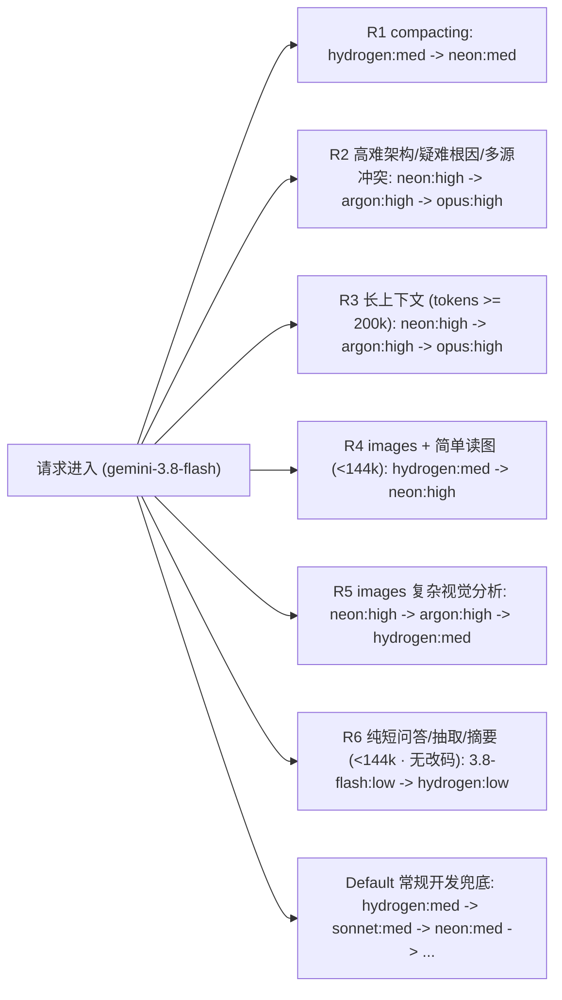
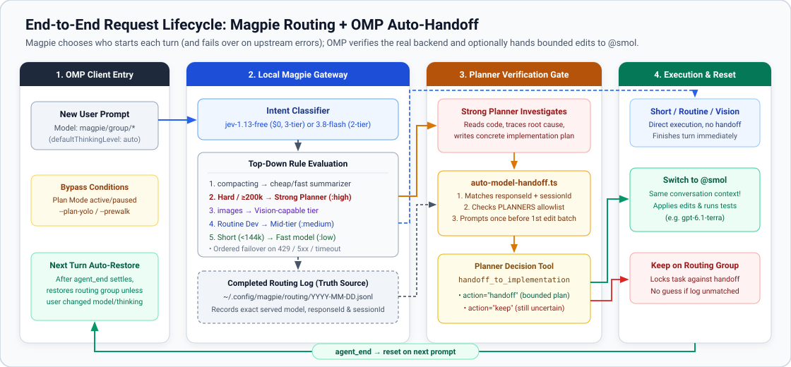

# OMP + Magpie 智能工作流：三策略组架构与建设心得

  <a href="README.md"><strong>English + Bilingual Main README (英文在前)</strong></a> &nbsp;·&nbsp;
  <strong>简体中文独立版</strong>

**一套经过真实流量验证、可一键复刻的 [OMP (oh-my-pi)](https://github.com/can1357/oh-my-pi) + 本地 Magpie 多模型路由工作流：包含三个互补策略组的完整架构设计、同会话规划交接扩展，以及可直接照抄的换机搭建脚本。**

---

## 一、三大策略组横向对比

三个策略组共用同一底座：**`routing=order`（按序确定性容灾）+ `stays=turn`（每轮用户提问独立重路由）**。

| 维度 | `group/smart-workflow` | `group/smart-omni` | `group/antigravity-pro` |
| --- | --- | --- | --- |
| **定位** | OMP 质量主力 + 自动规划交接 | 全渠道错峰池（极致省 Token + 高容灾） | 纯 `agy-cli` 长上下文与多模态专用 |
| **分类器 / 阈值** | `jev-1.13-free`（免费）/ `0.5` | `jev-1.13-free`（免费）/ `0.35` | `agy-cli/gemini-3.8-flash` / 默认 |
| **意图分流模式** | **显式三档**（高难 / 常规 / 短任务） | **显式三档**（高难 / 常规 / 短任务） | **两极 + Default 接常规**（通用分类器） |
| **容灾池深度** | 7 个模型（4 家渠道） | 16 个模型（6 家渠道） | 8 个锁档槽位（纯 `agy-cli`，512k 上下文） |
| **视觉规则 (`images`)** | 1 条：`terra:med -> sonnet:med -> sol` | 落 Default（首选 `hydrogen`） | **两级视觉分流**：`<144k` 简单读图走 `hydrogen`，复杂走 `neon:high` |
| **长上下文门控** | 短任务限 `tokens < 144k` | 短任务限 `tokens < 144k` | `tokens >= 200k` 强制升格 `neon:high`；简单读图与短问答限 `< 144k` |
| **Effort 锁定** | 规则 + 成员全锁（`high`/`medium`/`low`） | 规则层全锁（`high`/`medium`/`low`） | 全部 8 个成员硬锁（`high`/`medium`/`low`） |
| **OMP 自动交接** | **启用**：Rule 2 强模型联动 [`auto-model-handoff.ts`](auto-model-handoff.ts) | 仅路由，不触发交接 | 仅路由，不触发交接 |

---

## 二、三组精确规则拓扑

### 1. `group/smart-workflow`（OMP 质量主力 + 自动交接）

### 2. `group/smart-omni`（全池错峰 · 极省 Token 与高容灾）

### 3. `group/antigravity-pro`（纯 `agy-cli` · 长文与两级视觉特化）

---

## 三、端到端生命周期与同会话规划交接

**Magpie 决定「每轮谁开局 + 上游容灾」，OMP 扩展决定「强模型规划完后是否把边界明确的实施交接给 `@smol`」。**

---

## 四、六条核心建设心得

1. **免费专用分类器（`jev-1.13-free`）必须配显式常规开发 Rule**：仅配「高难/极简」两档时，普通写代码（如 JSONL 转 CSV、LRU Cache + 单测）会被吸进高难池；加显式常规开发 Rule 后精准回归 `Terra:med` / `Hydrogen:med`（`sure=0.985–1.0`），分类延迟 `0.37–1.25s` 且 `$0`。通用分类器（如 `gemini-3.8-flash`）则无需加。
2. **全程锁定 Reasoning Effort**：通过成员后缀（`:low`/`:medium`/`:high`）与规则级 `use-effort`，彻底杜绝高难任务掉 `low`、常规任务空烧 `high` 的倒挂。
3. **短任务加 `tokens < 144k`，超长文加 `tokens >= 200k`**：长会话中途不切廉价模型以保住 Prompt Cache；超过 200k 时在 `antigravity-pro` 自动升格强长文模型。
4. **`images` 规则排在短任务之前**：防止截图误入纯文本或弱视觉小模型；高频多模态场景可拆分为「简单读图 `<144k`」与「复杂排障」两级。
5. **网关与 Agent 职责解耦**：Magpie 管无状态路由/容灾/压缩，[`auto-model-handoff.ts`](auto-model-handoff.ts) 通过匹配本地 `routing/*.jsonl` 精确核对真实后端后管理同会话交接。
6. **按场景选组，不做大杂烩**：质量+交接用 `smart-workflow`，跨渠道省钱抗限流用 `smart-omni`，超长文/多模态用 `antigravity-pro`。

---

## 五、换电脑快速搭建

1. 接入本地 Magpie 渠道后运行 `magpie models` 核对精确模型 ID。
2. 按你的可用模型修改 [`examples/setup-groups.sh`](examples/setup-groups.sh) 后执行 `./examples/setup-groups.sh all`（手动命令见 [`examples/magpie-routing.md`](examples/magpie-routing.md)）。
3. 运行 `magpie omp group/smart-workflow` 暴露给 OMP。
4. 将 [`examples/omp-config.yml`](examples/omp-config.yml) 合并到 `~/.omp/agent/config.yml`。
5. 复制 [`auto-model-handoff.ts`](auto-model-handoff.ts) 到 `~/.omp/agent/extensions/`，重启 OMP 并在 `/extensions` 确认启用。
6. 发送短/中/难三类测试提示，通过 `~/.config/magpie/routing/YYYY-MM-DD.jsonl` 确认命中规则、`served` 模型和最终 `effort`。

仓库不含任何模型服务凭据、路由日志或会话历史。
