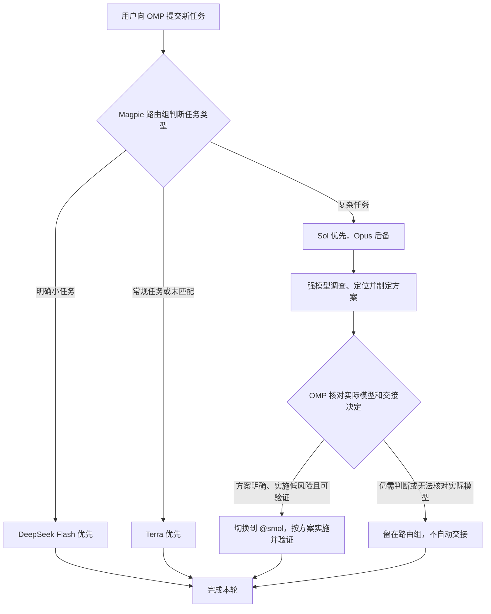

# OMP + Magpie 智能工作流

[English](README.md)

**按任务难度选择模型；规划完成后，在同一会话中把边界明确的实施工作交给更轻量的模型。**

## 工作流架构

这套工作流不要求用户事先选模型，也不把每个复杂任务都转交给更轻量的模型。**Magpie 决定这一轮由谁开始，OMP 决定规划完成后要不要换模型继续。** 交接留在同一会话，不用重新解释问题或复制上下文。

**例子：修复任务调度器偶发的重复执行。** Sol 先追踪重试和并发路径。如果确认同一个任务能被两名 worker 同时认领，并明确了修复点、要保持的不变量和回归用例，就可以把实施交给 `@smol`（示例配置里是 Terra）。如果还不能判断锁和事务的边界，就选择 `keep`，留在路由组继续调查。

## 路由规则

| 任务 | 示例配置中的优先模型 |
| --- | --- |
| 简短事实查询、单条明确命令或一处机械修改 | DeepSeek Flash，推理级别 `low` |
| 常规工作或未匹配任何意图 | GPT-6.1 Terra |
| 架构、迁移、根因不明的问题或复杂不变量 | GPT-6.2 Sol，Claude Opus 后备 |
| 上下文压缩 | Terra，必要时用 Flash |
| 规划后边界明确的实施 | OMP 的 `@smol` 角色，示例为 Terra |

复杂改动先调查，再决定是否交接。交接计划应写清文件、设计决定、约束和验证方法。扩展按会话和响应 ID 核对 Magpie 已完成的路由记录，确认实际提供回复的是哪个模型。如果规划模型尚未作决定，扩展会在首批符合条件的 `edit`、`write` 或 `apply_patch` 调用前提醒一次。选择 `keep` 后，本任务不再交接。当前任务结束后再发新消息，扩展会恢复路由组，除非用户已手动选择模型、思考级别或模式。

## 安装

1. 使用 [OMP](https://github.com/can1357/oh-my-pi) 和**本地** Magpie 网关，并接入你能使用的模型服务。已验证环境为 Windows、OMP `19.1.0` 和 Magpie `0.1.4573`；其他版本和系统尚未验证。模型 ID 可以换成你自己的。
2. 按 [Magpie 路由示例](examples/magpie-routing.md) 创建路由组。通过 Magpie 的 Agents 页面或 `magpie omp group/smart-workflow` 把 `group/smart-workflow` 提供给 OMP。已接入 Magpie 的 OMP 可以保留现有 provider 配置。
3. 把 [`modelRoles` 示例](examples/omp-config.yml) 合并到生效的 OMP `config.yml`（默认 `~/.omp/agent/config.yml`），不要覆盖整个文件。`@smol` 应指向支持工具调用的实施模型，而不是路由组。替换规划模型时，把扩展中的 `PLANNERS` 改成路由记录里实际提供服务的 provider/model ID。
4. 把 [`auto-model-handoff.ts`](auto-model-handoff.ts) 复制到当前 agent 目录的 `extensions/`，重启 OMP，再用 `/extensions` 确认扩展已加载。扩展默认从 `~/.config/magpie/routing` 读取路由记录；如果移动过 Magpie 数据目录，把 `ROUTING_DIR` 改为实际路径。

## 验证

- 运行 `magpie group smart-workflow`，核对成员顺序、分类模型和规则优先级。不指定模型启动 OMP，分别提交简短事实问题和复杂任务。OMP 可能只显示 `magpie/group/smart-workflow`，实际服务模型要看对应的 Magpie 路由记录。意图分类和故障转移都可能改变实际选择。
- 在临时工作区提交一个需要调查、但方案明确后实施范围有限的任务。确认 `handoff_to_implementation` 成功、模型切到 `@smol`，并发生实际文件修改和验证。等任务结束再发一条新消息，确认恢复路由组。

## 使用边界

- 这套机制只负责模型选择，**不替代写入防护或工具审批**。提醒只针对上述文件工具；Shell、嵌套工具和其他修改途径不受它拦截，原有 OMP 审批仍然生效。
- OMP `19.1.0` 的 `before_agent_start` 不区分运行中的补充（steering）与排队的 follow-up；后者可能沿用 `@smol`。希望重新路由时，请等当前任务结束再发下一条。
- 使用原生 Plan Mode 或 Prewalk 时，不要让两套机制同时接管。扩展会让位于可检测的 Plan Mode 及显式启动参数 `--plan-yolo` / `--prewalk`，但无法识别启动后所有启用 Prewalk 的方式。用自动或手动 Prewalk 时，请先关闭本扩展。
- 找不到或无法匹配路由记录时，扩展不会猜测后端，也不会自动切换；Magpie 路由仍然可用。
- 要停止自动交接，在 `/extensions` 中关闭 `auto-model-handoff`。要完全停用这套工作流，再把默认模型切回原来的选择，不需要动其他配置或凭据。

仓库包含扩展、文档和配置示例，不含模型服务凭据、路由日志或会话历史。
